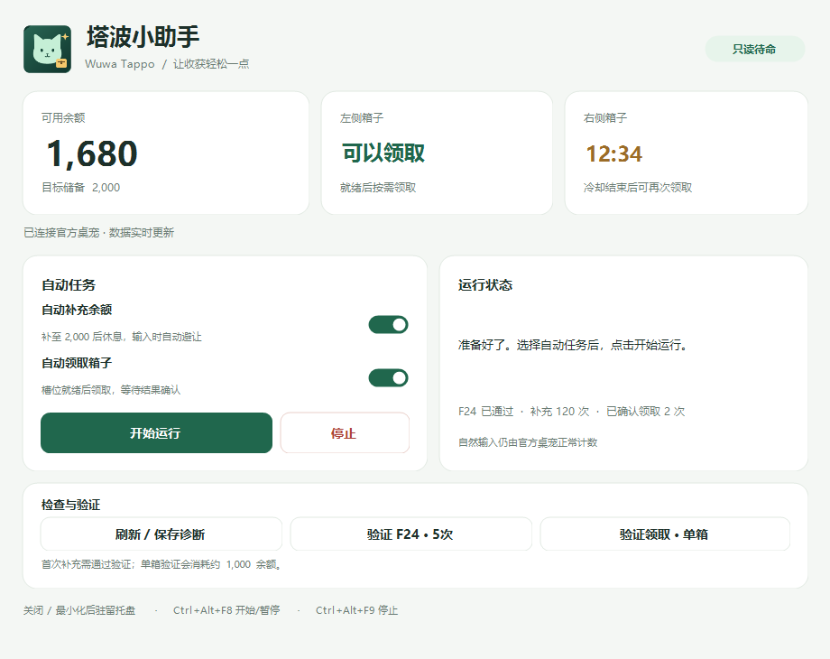

# Wuwa Tappo Helper · 塔波小助手

面向 Windows 的非官方桌宠助手：按界面状态补充次数、领取就绪箱子，并在输入和编辑文字时避让。

本项目仅供个人学习、技术交流与实现参考，不提供代练或收益保证服务；这一用途说明不改变 MIT 许可证授予的权利。

以日常桌面使用为先：需要时补充，输入时避让，领取结果按界面变化核对。状态和暂停原因尽量明确，便于随时接管。

> **非官方项目，未获库洛游戏、鸣潮或 Wuwa Tappo 的授权、认可或背书。** 自动化可能受到官方协议与活动规则限制。本项目不承诺账号安全、计数有效或奖励到账；不修改官方文件也不代表获得官方许可。使用前请阅读[免责声明](docs/DISCLAIMER.md)。

**[下载最新版](https://github.com/Yig524/WuwaTappoHelper/releases/latest) · [安装与使用](docs/INSTALL.md) · [常见问题](docs/INSTALL.md#常见问题) · [免责声明](docs/DISCLAIMER.md) · [来源与授权](THIRD_PARTY_NOTICES.md)**



## 下载哪个文件？

| 你的需求 | 应选择的文件 |
| --- | --- |
| 直接使用，推荐 | 本仓库 Releases 中的 **`WuwaTappoHelper-windows.zip`** |
| 查看、修改或自己编译 | `WuwaTappoHelper-source.zip`，或 GitHub 的 `Source code (zip)` |

在[最新版 Release](https://github.com/Yig524/WuwaTappoHelper/releases/latest)页面展开 **Assets**，下载 `WuwaTappoHelper-windows.zip`。**源码包没有现成启动 EXE；Windows 发布包必须完整解压，不能只拿出 EXE。**

## 快速开始

系统要求：Windows 10/11、Windows PowerShell 5.1、.NET Framework 4.8。官方 WuwaTappo 需自行安装并登录；当前适配并校验的是官方 **1.0.2**。

1. **解压整个发布包。** 找到含 `WuwaTappoHelper.exe` 的目录；也可先双击其中的 `开始使用.html` 查看离线指引。
2. **完成首次使用向导。** 点击“选择程序…”选中官方 `WuwaTappo.exe`，校验版本并只读检查连接；最后保存路径、进入主界面。暂未登录时可选择“稍后连接”。无需手动编辑JSON。[向导与高级配置](docs/INSTALL.md#第二步完成首次使用向导)
3. **核对连接。** 双击助手 EXE，核对来源并处理UAC；按向导手动启动官方桌宠、登录并等待连接。进入主界面后核对余额和箱子状态，暂不开自动任务。
4. **需要补余额时先验证。** 点击“验证 F24 · 5次”，保持助手在前台、停止键鼠操作约12秒，等待验证通过。每次重开助手或官方窗口身份变化后需重新验证。
5. **按需开启任务。** 选择“自动补充余额”和/或“自动领取箱子”，点击“开始运行”。“验证领取 · 单箱”是可选测试，**会真实消耗约1,000余额**，不是模拟预览。
6. **使用托盘退出。** 窗口的“×”和最小化只隐藏至托盘；真正退出请右键托盘图标选择“退出程序”。

首次使用、没有识别到窗口、不会改JSON或一直避让时，请看[完整图文说明](docs/INSTALL.md)。发布包为便携版，无需安装 Python、Node.js、PowerShell 7 或 Visual Studio。

首次设置或配置失效时显示向导；取消不覆盖配置，保存后正常启动会跳过。需要重设时，先退出助手，再运行 `.\WuwaTappoHelper.exe --setup`。向导只读检查，不自动发键、领取或启用任务。

## 运行规则

- 目标储备为2,000，按余额反馈调度；就绪箱子优先处理，左右槽位分别观察，领取后等待界面结果确认，不加速官方冷却。
- 键盘停止输入约1秒后尝试恢复；文字编辑焦点、候选窗口、持续按键/拖拽期间避让，鼠标移动、滚轮不延长等待。
- 输入框仍有焦点时会持续保护，点击框外恢复；开启中文布局或讯飞本身不会整段拦截。不保证所有自绘编辑器和输入法都兼容。
- 两个自动任务默认关闭；仅使用自动领取时不要求F24验证，余额可来自自然输入。
- 补充至目标、等待领取、冷却、数据异常或输入避让都可能使程序暂缓动作，具体原因显示在状态区。

| 操作 | 方式 |
| --- | --- |
| 开始 / 暂停 | 主按钮，或 `Ctrl+Alt+F8` |
| 停止自动动作 | “停止”，或 `Ctrl+Alt+F9` |
| 恢复窗口 | 双击托盘图标 |
| 真正退出 | 托盘右键 → 退出程序 |

## 数据与权限

助手使用系统级F24模拟输入、UI Automation读取及调用界面控件，不移动鼠标，不修改官方EXE、存档、内存或联网接口，不自行构造奖励网络请求。F24仍可能被其他软件响应，发现干扰时先停止。

图形启动器不创建PowerShell控制台，当前统一通过正常UAC请求管理员权限。不要求账号密码，不读取Cookie或官方账号存档，不提供日志上传功能。连接状态、余额、槽位与输入避让诊断保存在本机 `diagnostics/`，可能包含路径、窗口标识和余额，分享前请检查并脱敏。官方桌宠自身的联网与账号处理由官方软件管理。

## 升级与卸载

升级前从托盘退出旧助手，完整解压新版，需要时复制自己的 `helper-config.json`，然后重新连接、验证。不要只替换EXE或覆盖正在运行的文件。

卸载时退出助手，删除助手目录及自行创建的快捷方式即可；本项目不设置服务、计划任务或开机启动。删除助手不能撤销已经发生的计数、领取或服务端处理。

## 从源码构建

以下供开发者使用。进入源码根目录，在系统 **Windows PowerShell 5.1** 中执行：

```powershell
powershell.exe -NoProfile -ExecutionPolicy Bypass -File .\Build-UiaHost.ps1
```

生成根目录的 `WuwaTappoHelper.exe` 后，按上述步骤配置并运行。构建使用系统 C# 编译器，自动生成原创图标；运行中的启动文件不能直接覆盖，构建前退出助手，或用 `-OutputPath` 指定其他文件名。

回归检查与打包：

```powershell
powershell.exe -NoProfile -ExecutionPolicy Bypass -File .\Run-Tests.ps1
powershell.exe -NoProfile -ExecutionPolicy Bypass -File .\Build-Release.ps1
```

发布包输出到 `dist/WuwaTappoHelper-windows.zip`。测试使用合成状态和自己的离屏控件，不向官方程序发键或领取箱子；自动测试通过不等于所有真实输入法、30分钟冷却、锁屏和休眠恢复场景都已验证。

本机配置、日志、测试输出、EXE及ZIP已由 `.gitignore` 排除。提交仓库时以本目录为根目录，不包含上一级官方软件，也不要直接上传包含运行数据的整个工作目录。

## 免责声明与授权

本项目是独立的个人桌面自动化工具，与官方无隶属、合作或授权关系。自动化可能带来统计不被认可、奖励或活动资格变化、账号处理及电脑操作干扰等风险；是否使用应结合官方规则与个人风险承受能力判断。**不保证不受限制、不保证收益、不保证服务端认可界面上的结果。**

软件按现状提供，保证与责任限制以[MIT许可证](LICENSE)及适用法律为准；本说明不声称排除依法不能排除的责任。项目免费公开维护，不提供代练、账号或收益保证服务，也不把“仅供学习”视为官方授权或责任豁免。

代码及本项目原创图标采用MIT；本仓库不分发官方程序、角色或箱子素材。MIT本身允许的使用和分发权利不另加禁止商用限制，第三方商标和素材的权利仍归其权利人。完整说明见[使用风险与免责声明](docs/DISCLAIMER.md)。
